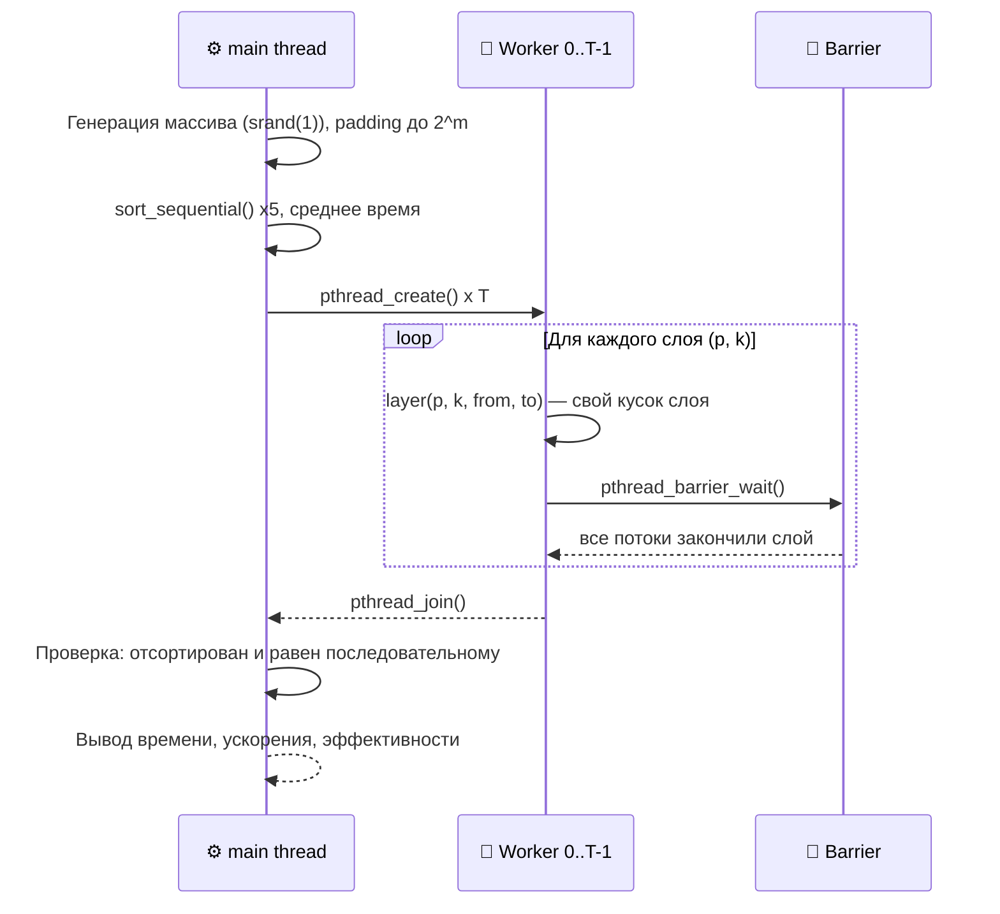

<div align="center">


<p align="center">
  
  
  
  
</p>

</div>

---

## 💡 О проекте

Лабораторная работа №2 по курсу **«Операционные системы»**: многопоточная обработка данных на POSIX Threads. Реализованы последовательная и параллельная версии **чётно-нечётной сортировки Бетчера**, измерены время работы, ускорение и эффективность.

**Ключевые концепции под капотом:**
* 🧵 Создание и ожидание потоков (`pthread_create`, `pthread_join`)
* 🚧 Синхронизация слоёв сортирующей сети барьером (`pthread_barrier_*`)
* ⏱ Замер реального времени (`clock_gettime(CLOCK_MONOTONIC)`)
* 🔍 Наблюдение за потоками средствами ОС (`ps -T`, `/proc/PID/status`)

---

## 🎯 Вариант 5: Постановка задачи

> Отсортировать массив целых чисел чётно-нечётной сортировкой Бетчера. Реализовать последовательную и параллельную версии, измерить время их работы. Максимальное число одновременно работающих потоков задаётся ключом запуска.

📌 **Как это устроено:**
1. Сортировка Бетчера — это **сортирующая сеть**: набор слоёв компараторов, порядок которых не зависит от данных.
2. Внутри одного слоя пары элементов не пересекаются, поэтому слой делится между потоками **без мьютексов**.
3. Между слоями стоит **барьер**: следующий слой использует результат предыдущего.
4. Массив дополняется значениями `INT_MAX` до ближайшей степени двойки; после сортировки они оказываются в конце.

*Для массива из 2^m элементов в сети m(m+1)/2 слоёв (при n = 2^20 — 210).*

---

## 🏗 Архитектура



### 📂 Файлы

| Файл | Назначение |
| :--- | :--- |
| `main.c` | Последовательная и параллельная сортировка, замеры, ключи запуска |
| `test.c` | Тесты корректности (подключает `main.c`) |
| `CMakeLists.txt` | Сборка `main` и `test` |
| `Report_Lab2.docx` | Отчёт с исследованием ускорения и эффективности |

---

## 🛠 Сборка

**Требования:** `CMake` (минимум `4.2`), компилятор C с поддержкой **C23**, `pthread`.

```bash
mkdir cmake-build-debug && cd cmake-build-debug
cmake ..
make
```

Либо напрямую через gcc:

```bash
gcc -O2 -Wall -pthread main.c -o main
gcc -O2 -Wall -pthread test.c -o test
```

---

## 🚀 Запуск

```bash
./main -t 8 -n 1000000
```

| Ключ | Описание | По умолчанию |
| :--- | :--- | :--- |
| `-t T` | число потоков | `4` |
| `-n N` | размер массива | `1000000` |
| `-w S` | демонстрация потоков: программа печатает `pid`, и каждый поток спит `S` секунд (в замер не входит) | `0` |

**Посмотреть количество потоков:**

```bash
./main -t 16 -w 10 &
ps -T -p <PID>               # список потоков
grep Threads /proc/<PID>/status   # Threads: 17 (16 рабочих + главный)
```

---

## 🧪 Тесты

```bash
./test
```

Проверяются: случайный массив, уже отсортированный, обратный (размер не степень двойки), с повторами, с отрицательными числами, потоков больше элементов, большой массив на 16 и 1024 потоках. Для каждого теста: результат отсортирован, сумма элементов сохранена, параллельный результат совпадает с последовательным.

<details>
<summary><b>🟢 Ожидаемый вывод (фрагмент)</b> <i>(Нажмите, чтобы развернуть)</i></summary>

```text
test 1, random, n = 8, threads = 2: OK
  before: 5 2 7 1 8 3 6 4
  after:  1 2 3 4 5 6 7 8
...
test 8, big random array, n = 100000, threads = 16: OK
test 9, big random array, n = 100000, threads = 1024: OK
all tests passed
```
</details>

---

## 📊 Результаты исследования

Система: Intel Core i5-14450HX (10 ядер: 6 P с Hyper-Threading + 4 E, 16 логических), WSL Ubuntu, `gcc -O2 -pthread`. Время — среднее из 5 запусков.

**n = 1 000 000, T₁ = 630.79 мс**

| Потоков | Время, мс | Ускорение | Эффективность |
| :---: | :---: | :---: | :---: |
| 1 | 627.78 | 1.00 | 1.005 |
| 2 | 332.62 | 1.88 | 0.939 |
| 4 | 182.52 | 3.44 | 0.860 |
| 8 | 146.53 | 4.26 | 0.533 |
| 16 | 111.09 | **5.61** | 0.351 |
| 128 | 230.88 | 2.71 | 0.021 |
| 512 | 875.06 | 0.72 | 0.001 |
| 1024 | 1747.61 | 0.36 | ~0 |

**Зависимость от размера массива, p = 16**

| Размер | T₁, мс | Tₚ, мс | Ускорение | Эффективность |
| :---: | :---: | :---: | :---: | :---: |
| 100 000 | 56.62 | 27.02 | 2.10 | 0.131 |
| 1 000 000 | 626.08 | 108.95 | 5.75 | 0.359 |
| 4 000 000 | 3040.99 | 435.54 | 6.98 | 0.436 |

**Выводы:**
* До числа ядер время падает, максимум ускорения (≈5.6) — на 16 потоках.
* Эффективность падает: на каждом слое все ждут самого медленного на барьере, а скорость памяти ограничивает рост.
* Гетерогенный процессор (P- и E-ядра, Hyper-Threading) ухудшает эффективность при p ≈ 16.
* При p ≫ числа ядер доминируют переключения контекста и пробуждение потоков на барьерах — время растёт.
* На малых массивах накладные расходы занимают большую долю, поэтому ускорение ниже.

Подробности — в [`Report_Lab2.docx`](Report_Lab2.docx).

<br>
<div align="center">
  <i>Разработано в рамках курса Операционных Систем 💻</i>
</div>
