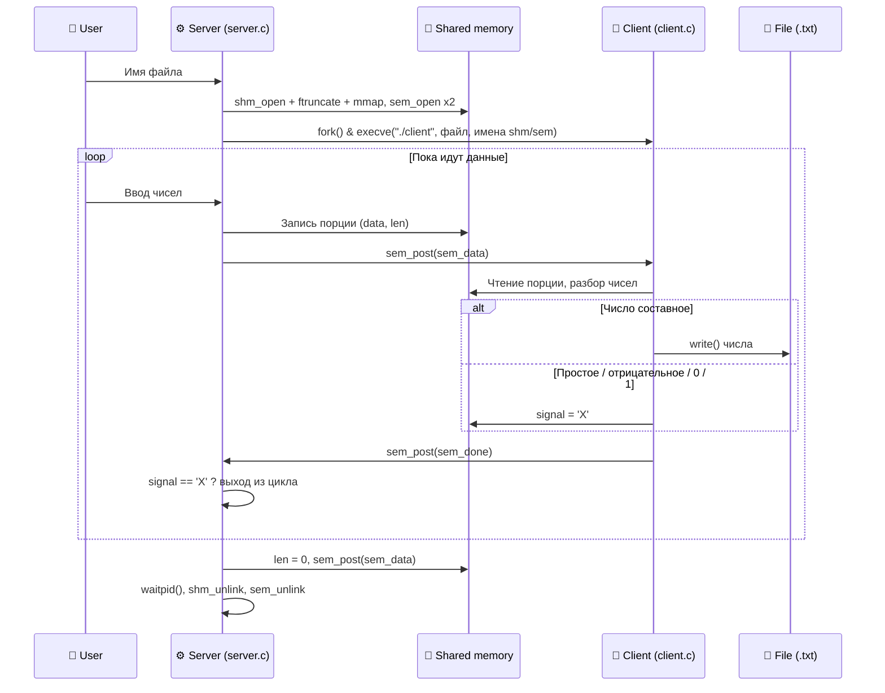

<div align="center">


<p align="center">
  
  
  
  
</p>

</div>

---

## 💡 О проекте

Лабораторная работа №3 по курсу **«Операционные системы»**. Программа первой лабораторной (родитель и потомок, обмен через `pipe`) переработана так, чтобы данные передавались через **именованную разделяемую память** (`shm_open` + `mmap`), а процессы синхронизировались **именованными семафорами**.

**Ключевые концепции под капотом:**
* 🧠 Именованная shared memory в RAM (`/dev/shm`): `shm_open`, `ftruncate`, `mmap`, `munmap`, `shm_unlink`
* 🚦 Именованные семафоры: `sem_open`, `sem_post`, `sem_timedwait`, `sem_unlink`
* 🧬 `fork` + `execve`, контроль живости партнёра (`waitpid(WNOHANG)`, `getppid`)
* 🧹 Корректная очистка объектов, в том числе по `Ctrl+C` (`sigaction` + `SIGINT`)

---

## 🎯 Вариант 5: Постановка задачи

> Пользователь вводит числа. **Server** (родитель) передаёт их **client** (потомок), а тот проверяет число на простоту.

🛠 **Логика обработки чисел client:**
1. 🧮 **Составные числа** записываются в файл (имя файла пользователь вводит первой строкой в server).
2. 🛑 **Простые, отрицательные, `0` и `1`** завершают оба процесса.
3. ⚠️ Слишком большое число (не помещается в `long long`) пропускается с сообщением.

*Имена shared memory и семафоров **не константы**: они строятся из `pid` сервера (`/lab3_shm_<pid>`, `/lab3_data_<pid>`, `/lab3_done_<pid>`), поэтому несколько пар server-client могут работать одновременно.*

---

## 🏗 Архитектура процессов

В разделяемой памяти лежит структура:

```c
typedef struct {
    int  len;          // сколько байт ввода лежит в буфере (0 = конец)
    char signal;       // 'X' ставит client при завершающем числе
    char data[128];    // порция ввода
} shared_t;
```

Два семафора (начальное значение `0`) заставляют процессы работать строго по очереди, поэтому гонок нет:

| Семафор | Кто делает `post` | Кто ждёт | Смысл |
| :--- | :--- | :--- | :--- |
| `sem_data` | server | client | «данные готовы» |
| `sem_done` | client | server | «порция обработана» |



### 👨‍👦 Роли процессов

| Процесс | Файл | Основные задачи |
| :--- | :--- | :--- |
| **Server** | `server.c` | Чтение имени файла, создание shm и семафоров с именами от `pid`, `fork` + `execve`, передача порций ввода, ожидание client с таймаутом (0,1 с) и проверкой `waitpid`, обработка `SIGINT`, удаление всех объектов |
| **Client** | `client.c` | Открытие shm и семафоров по `argv`, разбор чисел (число может быть разрезано между порциями), проверка на простоту, запись в файл, выставление `'X'`, проверка живости server через `getppid` |

> Вместо `sem_wait` используется `sem_timedwait` с периодической проверкой, жив ли второй процесс. Благодаря этому при аварии партнёра процесс не зависает на семафоре.

---

## 🛠 Сборка проекта

**Требования:** `CMake` (минимум `4.2`), компилятор C с поддержкой **C23**, Linux (POSIX shm + semaphores).

```bash
mkdir cmake-build-debug && cd cmake-build-debug
cmake ..
make
```

Либо напрямую:

```bash
gcc -O2 -Wall -Wextra -pthread server.c -o server
gcc -O2 -Wall -Wextra -pthread client.c -o client
```

---

## 🚀 Запуск

```bash
./server
```

> ⚠️ **Важно:** бинарник `client` должен лежать в той же папке, откуда запускается `server` (запуск идёт как `./client`). Вручную `client` запускать не нужно.

---

## 🧪 Интерактивные тесты

<details>
<summary><b>🔵 Тест 1: Только составные числа, конец ввода по EOF</b> <i>(Нажмите, чтобы развернуть)</i></summary>

**Ввод пользователя:**
```text
out.txt
15
21 8
9
```
*(затем <kbd>Ctrl</kbd> + <kbd>D</kbd>)*

**Вывод в консоль:** `Nothing to read. Bye!`

**Содержимое `out.txt`:**
```text
15
21
8
9
```
</details>

<details>
<summary><b>🟢 Тест 2: Простое число посреди ввода</b> <i>(Нажмите, чтобы развернуть)</i></summary>

**Ввод пользователя:**
```text
res.txt
15 7 9
```

**Вывод в консоль:** `From parent: terminate signal 'X' reached. Exiting!`

**Содержимое `res.txt`:**
```text
15
```
</details>

<details>
<summary><b>🔴 Тест 3: Отрицательное число</b> <i>(Нажмите, чтобы развернуть)</i></summary>

**Ввод пользователя:**
```text
neg.txt
4 -9 15
```

**Вывод в консоль:** `From parent: terminate signal 'X' reached. Exiting!`

**Содержимое `neg.txt`:**
```text
4
```
</details>

<details>
<summary><b>🟡 Тест 4: Слишком большое число</b> <i>(Нажмите, чтобы развернуть)</i></summary>

**Ввод пользователя:**
```text
big.txt
99999999999999999999 1000000016
1
```

**Вывод:** `Number is too big, skipped. :(`, затем `From parent: terminate signal 'X' reached. Exiting!`

**Содержимое `big.txt`:**
```text
1000000016
```
</details>

<details>
<summary><b>🟣 Тест 5: Две пары одновременно и очистка /dev/shm</b> <i>(Нажмите, чтобы развернуть)</i></summary>

```bash
ls /dev/shm | grep lab3
# во время работы: lab3_shm_504, lab3_shm_506, sem.lab3_data_*, sem.lab3_done_* ...
# после завершения обеих пар вывод пустой
```
</details>

<details>
<summary><b>⚪ Тест 6: Ошибки</b> <i>(Нажмите, чтобы развернуть)</i></summary>

* Нет файла `./client` → `Something gone wrong with execve. :(` и `From parent: process stopped without signal. Exiting!`
* `client` убит через `pkill -9 client` → server не зависает, печатает `From parent: process stopped without signal. Exiting!`, объекты в `/dev/shm` удалены.
* `Ctrl+C` в server → `From parent: interrupted. Bye!`, объекты удалены.
</details>

Подробный протокол (включая `strace`) и выводы — в [`Report_Lab3.docx`](Report_Lab3.docx).

<br>
<div align="center">
  <i>Разработано в рамках курса Операционных Систем 💻</i>
</div>
